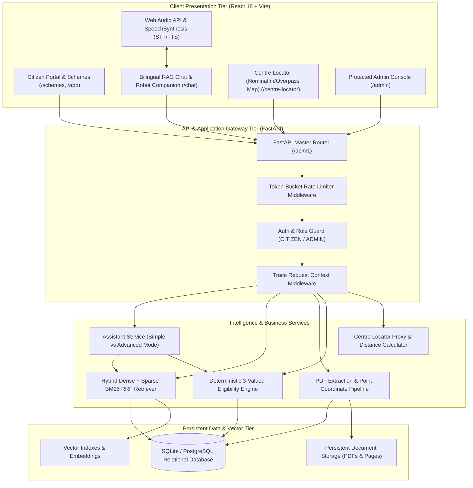
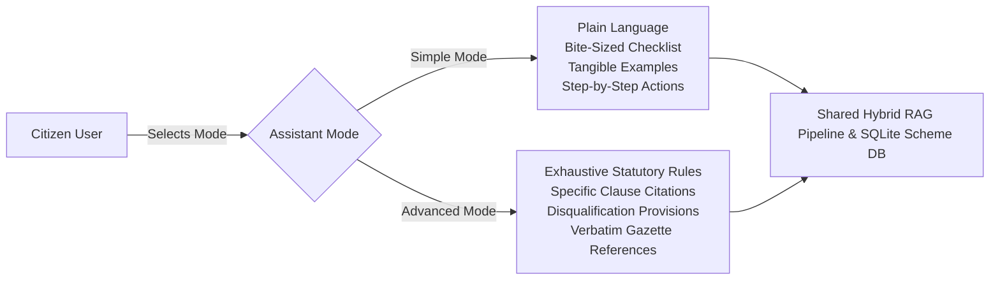
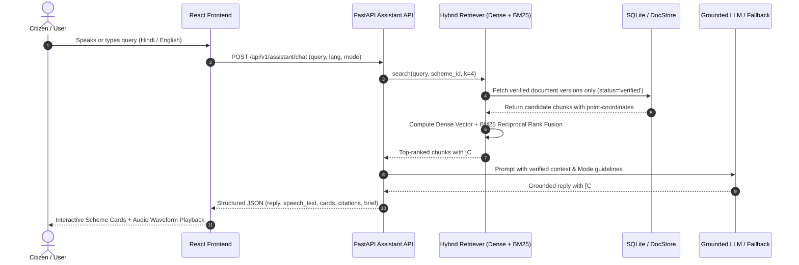

# Yojana Sahayak — Complete System Architecture & Engineering Blueprint

Yojana Sahayak is an authentic, bilingual (Hindi & English), evidence-grounded government scheme intelligence platform. It seamlessly links Indian citizens to central and state welfare programmes through deterministic eligibility checking, zero-hallucination hybrid RAG (Dense + BM25 RRF), and authentic Web Audio speech conversation.

---

## 1. High-Level System Architecture

---

## 2. Interaction Modes: Simple vs Advanced Mode

Yojana Sahayak supports two interaction modes backed by the **identical underlying RAG knowledge base, database, and citation verification engine**:

1. **Simple Mode (सरल मोड)**:
   - Tailored for everyday citizens.
   - Plain conversational phrasing, avoiding administrative jargon.
   - Tangible examples (e.g. ₹2,000 every 4 months directly into your bank account).
   - Bite-sized document checklists and clear next steps.
2. **Advanced Mode (उन्नत मोड)**:
   - Designed for policy researchers, legal advisors, administrators, and welfare advocates.
   - Comprehensive eligibility rules, statutory exclusion clauses, legal definitions, exact document versions, and verbatim gazette citations.

---

## 3. Grounded Hybrid RAG Pipeline Architecture

---

## 4. Persistent Relational Schema

The application persists all core entities in relational database tables:
- `users`: User identity, password hash (salted PBKDF2), role (`CITIZEN` / `ADMIN`), preferences.
- `citizen_profiles`: Comprehensive socio-economic, occupational, and demographic attributes.
- `schemes`: Public scheme records, category, ministries, descriptions (EN & HI).
- `documents` & `document_versions`: Official gazettes, storage keys, MIME type, hashes, approval statuses.
- `pages`, `chunks`, `chunk_boxes`: Page-bounded chunks with point-accurate bounding box coordinates.
- `eligibility_rules` & `rule_reviews`: Deterministic eligibility conditions, provenance quotes, page refs.
- `assessment_responses` & `assessment_history`: 7-step questionnaire in-progress and audit trail.
- `citizen_saved_schemes` & `application_tracker_records`: Bookmarks and application status timelines.
- `audit_events`: Full audit trail of administrative and citizen interactions.
